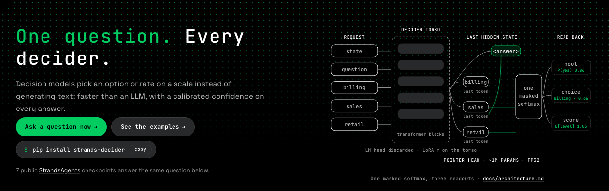
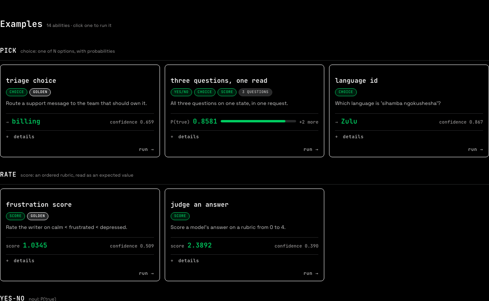
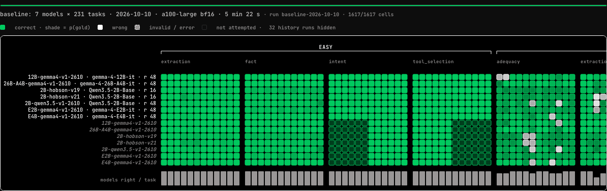
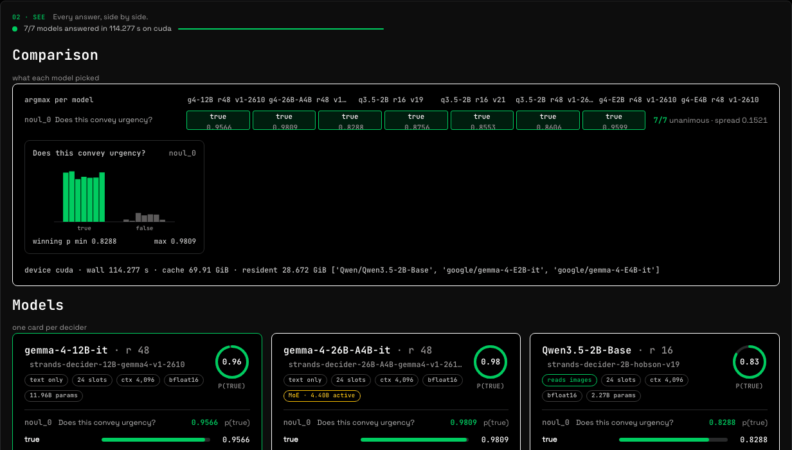
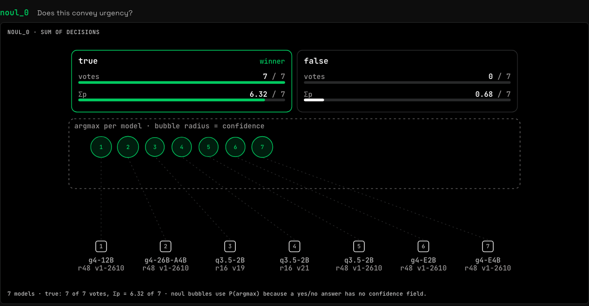
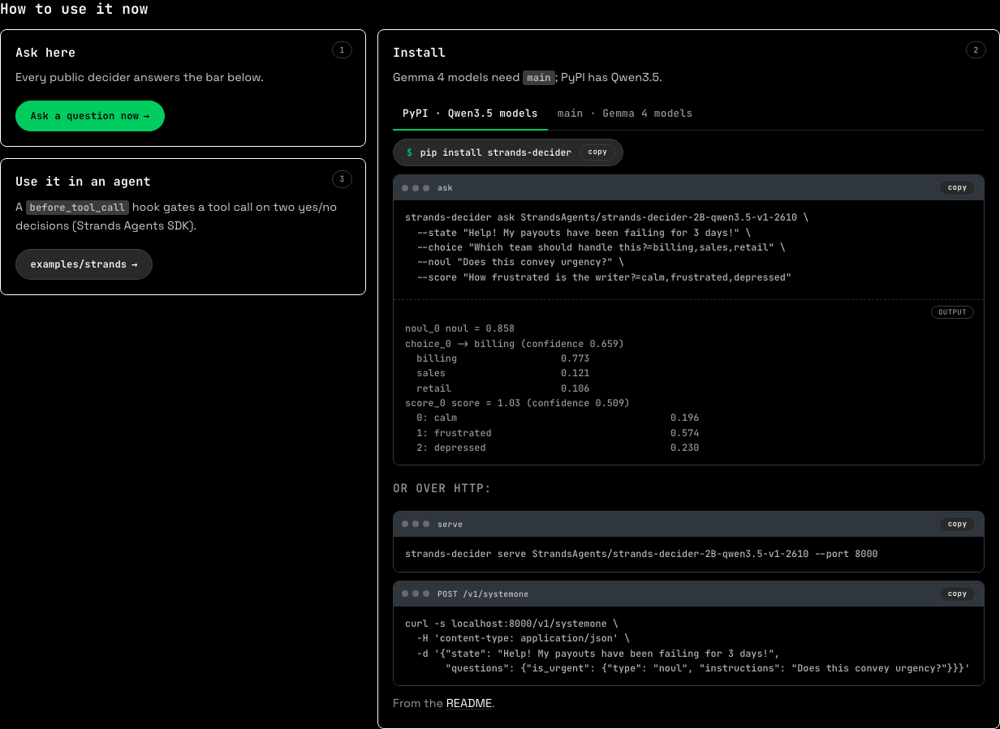
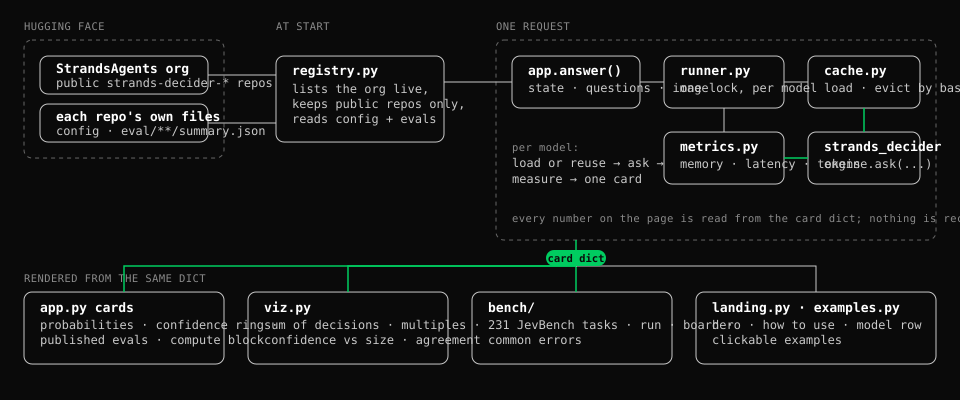

<p align="center">
  <br>
  <strong>Strands Decider Playground</strong>
</p>

<p align="center">
  <a href="https://huggingface.co/spaces/cagataydev/strands-decider-playground"></a>
  <a href="../LICENSE"></a>
  <a href="https://github.com/strands-labs/strands-decider"></a>
  <a href="https://github.com/fstandhartinger/jevbench"></a>
</p>

One question, asked of every public Strands decider at once — a probability per option, a
calibrated confidence, the measured cost, and the whole JevBench set runnable from one button.

<p align="center"><a href="https://huggingface.co/spaces/cagataydev/strands-decider-playground"><b>Open the Space →</b></a></p>



## What you can do here

- **Ask one question to seven models.** Paste a piece of state, pick yes/no (`noul`), pick-one
  (`choice`) or rate-on-a-scale (`score`), press Decide. One card per model: the probability of
  every option, a confidence ring, and load vs inference as two numbers.
- **Start from an example.** Fourteen cards, one per ability — triage, language id, judging an
  answer, three questions in one read, image questions — each a single click.
- **Drop an image.** Image input goes only to the models that can read it (Qwen3.5 bases); a
  text-only model refuses clearly instead of quietly ignoring the picture.
- **Watch the models disagree.** Below the cards the same answers are drawn as decision diagrams:
  each model's choice bubbles up to its option, sized by confidence; then confidence against active
  parameters and the model × model agreement matrix.
- **Run the whole JevBench.** 231 public tasks × every model, as a background job on the Space, with
  a contribution-graph board: green = right, white = wrong, shade = how sure.
- **Read the board.** Click a task column for every model's answer side by side; the panels below
  count the common errors per model and per task.

| | |
|---|---|
|  |  |
|  |  |

## The models

Every public `strands-decider-*` repo in the [StrandsAgents](https://huggingface.co/StrandsAgents)
org, read live when the page starts. JevBench is correct answers out of 231; Brier is lower-better;
p50 is median forward-pass latency on the Space's A100. Two Qwen3.5-2B repos at rank 16 and one at
rank 48 share a base — the digits in a repo name are not a size.

<!-- models:start -->
| model | base | LoRA r | JevBench | Brier | p50 |
|---|---|---:|---:|---:|---:|
| [strands-decider-12B-gemma4-v1-2610](https://huggingface.co/StrandsAgents/strands-decider-12B-gemma4-v1-2610) | gemma-4-12B-it | 48 | 200/231 | 0.198 | 136 ms |
| [strands-decider-26B-A4B-gemma4-v1-2610](https://huggingface.co/StrandsAgents/strands-decider-26B-A4B-gemma4-v1-2610) | gemma-4-26B-A4B-it | 48 | 199/231 | 0.200 | 200 ms |
| [strands-decider-E4B-gemma4-v1-2610](https://huggingface.co/StrandsAgents/strands-decider-E4B-gemma4-v1-2610) | gemma-4-E4B-it | 48 | 185/231 | 0.262 | 116 ms |
| [strands-decider-E2B-gemma4-v1-2610](https://huggingface.co/StrandsAgents/strands-decider-E2B-gemma4-v1-2610) | gemma-4-E2B-it | 48 | 178/231 | 0.340 | 101 ms |
| [strands-decider-2B-qwen3.5-v1-2610](https://huggingface.co/StrandsAgents/strands-decider-2B-qwen3.5-v1-2610) | Qwen3.5-2B-Base | 48 | 177/231 | 0.318 | 98 ms |
| [strands-decider-2B-hobson-v21](https://huggingface.co/StrandsAgents/strands-decider-2B-hobson-v21) | Qwen3.5-2B-Base | 16 | 171/231 | 0.357 | 95 ms |
| [strands-decider-2B-hobson-v19](https://huggingface.co/StrandsAgents/strands-decider-2B-hobson-v19) | Qwen3.5-2B-Base | 16 | 166/231 | 0.361 | 97 ms |

<sub>Generated by `docs/gen_readme_table.py` from `bench/baseline/meta.json` — 1617 cells captured 2026-10-10 04:55Z on NVIDIA A100-SXM4-80GB (a100-large, 80 GB), bf16; p50 is the forward pass alone. Base and rank are read from each repo's decider config.</sub>
<!-- models:end -->

## Run it yourself



```bash
git clone https://github.com/cagataycali/strands-decider-playground && cd strands-decider-playground
python -m venv .venv && . .venv/bin/activate
pip install -r requirements.txt     # pinned; strands-decider and jevbench at fixed commits
python app.py                       # http://127.0.0.1:7860
```

- **CPU is enough for the 2B.** Open *Image, models, pricing*, untick everything except
  `strands-decider-2B-qwen3.5-v1-2610`, press **Golden question**, then **Decide**.
- **All seven want a GPU.** The Space runs on an A100 80 GB; the 26B-A4B base alone is ~48 GiB of
  bf16 weights and evicts the others when it loads.
- **Re-run the bench without loading a model** — `bench/capture.py` drives the Space over the
  network and writes `bench/baseline/`, which is what the board shows first:

  ```bash
  python -m bench.capture baseline
  ```

- `HF_TOKEN` is only needed to push bench runs; `DECIDER_DEVICE=cpu|mps|cuda` overrides the device.

## How it works



- `registry.py` lists the org live and keeps public repos only — there is no hardcoded model list.
- One request → `runner.py` takes one lock per model, `cache.py` loads or reuses weights (evicting by
  base model), `metrics.py` measures memory, latency and tokens around `strands_decider`'s `ask`.
- Every card, diagram and board cell is rendered from that one result dict; nothing is recomputed.
- Load time is never added to inference latency; a number that cannot be measured says so instead
  of showing a plausible zero.
- `bench/` vendors the 231 JevBench tasks at a pinned commit and scores with JevBench's own code.
- The Qwen3.5 models run on the `flash-linear-attention` kernel (12–17 % faster forward); it shifts
  probabilities in the 3rd–4th decimal, so their baseline rows were re-captured on it — measured in
  [docs/how-it-works.md](../docs/how-it-works.md#the-bench).

The full story — the golden question, the baseline capture, environment variables, the
rules the app refuses to break — is in [docs/how-it-works.md](../docs/how-it-works.md).

## Credits and licence

- The deciders and the library: [strands-labs/strands-decider](https://github.com/strands-labs/strands-decider), Apache-2.0.
  Published per-task records and the paired-test script under `bench/published/` are copied from that repo.
- The benchmark: [JevBench](https://github.com/fstandhartinger/jevbench) by Florian Standhartinger and contributors, MIT,
  vendored under `bench/tasks/` with its licence.
- The look: design tokens, the frog mark and wordmark from [strands-labs/robots](https://github.com/strands-labs/robots), Apache-2.0;
  JetBrains Mono and Space Grotesk under the SIL Open Font License.
- Built by [strands](https://strandsagents.com).

MIT — see [LICENSE](../LICENSE), which also carries the third-party notices. Contributions: [CONTRIBUTING.md](../CONTRIBUTING.md).
