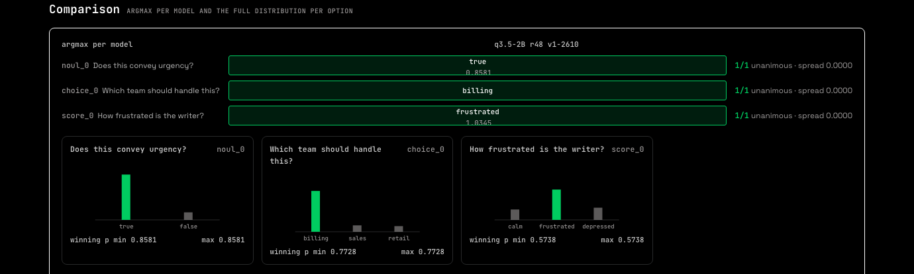
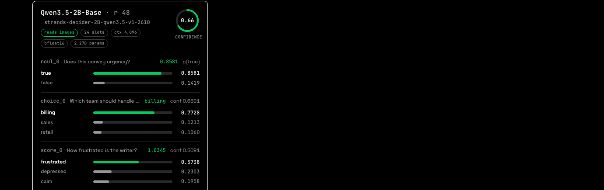
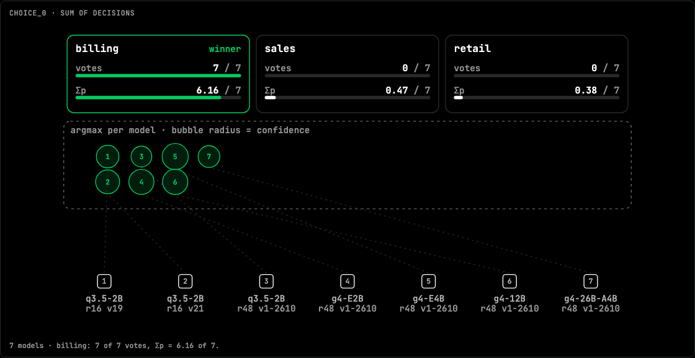
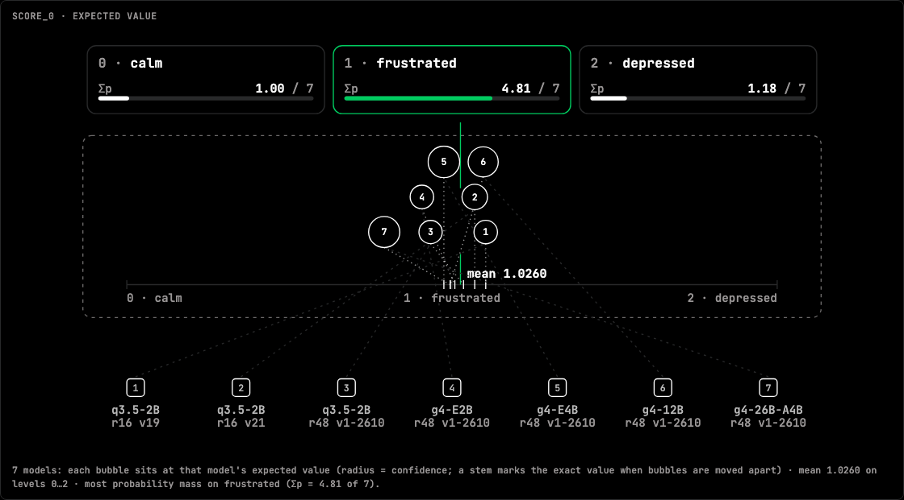
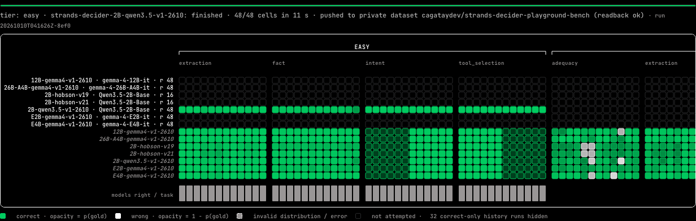

# Strands Decider Playground

One question. Every decider. Type a piece of state and a question, and every public
[StrandsAgents](https://huggingface.co/StrandsAgents) decider answers it side by side: a
probability for each option, a calibrated confidence, the model's own published evals, and the
measured compute cost of the call. Below the cards, the same answers are drawn as decision
diagrams, and the whole [JevBench](https://github.com/fstandhartinger/jevbench) public set can be
run against every model from one button.

A *decider* is a small post-tuned language model that answers a typed question about a piece of
state — yes/no (`noul`), pick one (`choice`), or rate on a rubric (`score`) — with a probability
for every option instead of free text. The models and the library are
[strands-labs/strands-decider](https://github.com/strands-labs/strands-decider).


## What you see

| | |
|---|---|
|  | **Comparison.** Argmax per model with the majority filled, then one small chart per question with the full distribution per option. |
|  | **One card per model**, labelled by base + LoRA rank (the digits in a repo name are not a size). Every answer with its bars; the ring is the calibrated confidence — a yes/no answer has none *by design*, so the ring shows p(true). Below the answers: the compute block (weights → baseline → peak, load vs inference on one axis, tokens, estimated FLOPs and $), then the published-eval badges, each linking to the exact `summary.json` it was read from. |
|  | **Decisions.** Each model's argmax bubbles up to its option; the columns show the vote count and the probability mass (Σp). Bubble radius is confidence. |
|  | For a `score` question the bubbles land on the ordered axis at each model's expected value. Two more diagrams follow: confidence against active parameters, and the NxN agreement matrix. |
|  | **JevBench board.** Task × model, contribution-graph style: accent = correct, ink = wrong, opacity = how sure. Click a column for the task in full, every model's answer side by side; the panels below count common errors per model, per task, models × tiers, and run the paired McNemar test strands-decider itself uses. |

## Things this app refuses to get wrong

- **The model list is read live from the org at start**, then filtered to public repos by the Hub's
  own `private` flag. There is no hardcoded list; `registry.py` is the whole rule.
- **Images only go to models that can read them.** Per the library's `docs/vision.md`, image input
  works on Qwen3.5 bases with a pointer head; Gemma 4 checkpoints load their base's text decoder
  and drop the vision encoder. Picking an image with a text-only model gives a clear refusal, not a
  silently text-only answer.
- **Load time is never added to inference latency.** A cold model must not look slow: the card
  shows them as two numbers and marks the call COLD or warm.
- **Every model call is serialized behind one lock**, so memory and latency are attributable to one
  request. Big models evict by base model rather than thrash; a model that cannot fit the device at
  all says so.
- **A number that cannot be reproduced is not shown.** Unmeasurable fields arrive as
  `UNAVAILABLE: <reason>`, never as a plausible zero. Every number on the page is read from the
  result dict in the *Raw result* accordion — nothing is recomputed in the renderer.

## Run it locally

```bash
git clone <this repo> && cd strands-decider-playground
python -m venv .venv && . .venv/bin/activate
pip install -r requirements.txt        # pinned; includes strands-decider and jevbench at fixed commits
python app.py                          # http://127.0.0.1:7860
```

- **CPU is fine for the 2B.** Open *Image, models, pricing*, untick everything except
  `strands-decider-2B-qwen3.5-v1-2610`, press **Load golden question**, then **Decide**. It answers
  in well under a minute.
- **A GPU is wanted for all seven.** The Space runs on an A100 (80 GB); the 26B-A4B base alone is
  ~48 GiB of bf16 weights and evicts the others when it loads.
- `HF_TOKEN` is read from the environment only (the Hub models are public; the token is needed for
  pushing bench runs). `DECIDER_DEVICE=cpu|mps|cuda` overrides the device pick;
  `DECIDER_ORG` / `DECIDER_PREFIX` point the registry at another org or name prefix.

### The golden question

`strands-decider-2B-qwen3.5-v1-2610` on the README example (*"Help! My payouts have been failing
for 3 days!"*) reproduces every published digit: `noul` 0.858 · `choice` billing 0.773 with
confidence 0.659 · `score` 1.03 with confidence 0.509. On the Space's A100 (bf16) the same call
gives 0.8553 / billing / 1.0354. If you change anything on the answer path, press **Load golden
question** and compare.

## The bench

`bench/` carries the 231 public JevBench tasks, vendored at a pinned commit
(`bench/tasks/PIN.json` has the commit and the sha256 of every file; `bench/tasks/LICENSE-jevbench`
is their MIT licence). Scoring is JevBench's own code at that same commit — `bench/jev.py` imports
it, it is never re-implemented. Before any model ran, `bench/parity.py` re-scored the three public
model repos' own published per-task records and reproduced their README totals exactly
(180 / 167 / 207 of 231, zero per-task mismatches); run it yourself after touching `bench/`.

**Run again.** Pick a scope (full set or one tier) and a model (or all) and press **Run JevBench**.
The run is a background job that calls `app.answer()` exactly as the Decide button does, appends one
row per task × model to `bench/runs/<run_id>/results.jsonl`, and shows progress on the board with an
ETA from its own measured pace. When it ends the folder is uploaded to a Hugging Face dataset so the
numbers survive a restart — set `BENCH_DATASET_REPO=<user>/<dataset>` (default
`cagataydev/strands-decider-playground-bench`; the upload is skipped without a token). A daily run
can be scheduled from the same row. The italic rows on the board are the published runs from the
strands-decider repo, for comparison.

## Architecture


| file | what |
|---|---|
| `app.py` | the Gradio page, the headless `answer()` entry point, and the card/comparison renderers |
| `registry.py` | live org read, public filter, capability detection, published evals, active-parameter arithmetic |
| `runner.py` | one locked call per model: load → answer → measure; question building; cross-model comparison |
| `cache.py` | base-keyed model cache with eviction and a dry-run `plan()` |
| `metrics.py` | the measurement: memory, latency, tokens, clearly-labelled estimates; same keys on cuda/mps/cpu |
| `landing.py` · `examples.py` · `viz.py` | hero + how-to + model row · clickable example gallery · decision diagrams |
| `bench/` | vendored JevBench tasks, pinned scoring, runner, board, error panels, parity gate |
| `static/` | design tokens, stylesheets, motion, the frog mark and wordmark, self-hosted fonts |

The design tokens come from the strands-labs/robots documentation: flat black or white surfaces,
one green (`#00cc60` dark, `#007a3d` light), 1 px ink outlines, 8 px radius, JetBrains Mono headings
over Space Grotesk text. Motion is 120–600 ms and lands instantly under `prefers-reduced-motion`.
No emoji in the UI.

## Credits and licence

- The deciders and the library: [strands-labs/strands-decider](https://github.com/strands-labs/strands-decider) (Apache-2.0). The
  published per-task records, task tiers and the paired-test script under `bench/published/` and
  `bench/paired_upstream.py` are copied from that repo.
- The benchmark: [JevBench](https://github.com/fstandhartinger/jevbench) by Florian Standhartinger and contributors (MIT),
  vendored under `bench/tasks/` with its licence.
- The look: design tokens and marks from [strands-labs/robots](https://github.com/strands-labs/robots) (Apache-2.0); JetBrains Mono and
  Space Grotesk under the SIL Open Font License.
- Built by [strands](https://strandsagents.com).

This repository is MIT licensed — see [LICENSE](LICENSE), which also lists the third-party notices
above. Contributions: [CONTRIBUTING.md](CONTRIBUTING.md).
